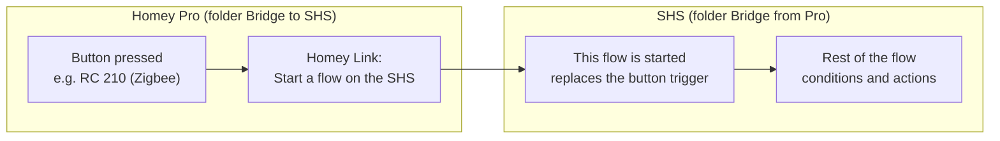

# Flow Mover — user guide

User guide for moving flows from a Homey Pro to a Homey Self-Hosted Server (SHS). Nederlandstalige versie: [HANDLEIDING.md](HANDLEIDING.md).

## Contents

- [What the Flow Mover does](#what-the-flow-mover-does)
- [Preparation](#preparation)
- [The eight steps in the app](#the-eight-steps-in-the-app)
- [Bridge flows](#bridge-flows)
- [Recommended order](#recommended-order)
- [Problems and solutions](#problems-and-solutions)
- [Cleaning up after the migration](#cleaning-up-after-the-migration)

## What the Flow Mover does

The Flow Mover is an app on the **Self-Hosted Server (SHS)**. It copies your flows, rooms, dashboards and favorites from the **Homey Pro** to the SHS. Nothing changes on the Pro, except the bridge flows you let it create and the flows you switch off in step 6.

The Flow Mover does not copy devices: Zigbee, Z-Wave and 433 MHz devices stay connected to the Pro's radios. Devices get onto the SHS either through **Homey Link** (a mirror of the device on the Pro), or because you add them directly on the SHS (Wi-Fi and cloud devices, such as Growatt, Chint or the Weishaupt boiler).

**Terms**

| Term | Meaning |
| --- | --- |
| Pro | The Homey Pro 2023, where your flows are now. |
| SHS | The Homey Self-Hosted Server in Docker, where the flows are going. |
| Homey Link | App on both Homeys. Shows devices of the other Homey and can start flows on the other Homey. |
| Matching | Finding, for every device on the Pro, the corresponding device on the SHS, so the cards in a flow point to the right device. |
| Link device | A device on the SHS that mirrors a device of the Pro through Homey Link. On/off, dimming and measurements work; app-specific cards (remote buttons, Growatt actions) do not. |
| Bridge flow | A small flow on the Pro that catches a button or trigger and starts the real flow on the SHS through Homey Link. |
| API key | A key you create in my.homey.app, so the Flow Mover may read or write on a Homey. |

Flows are created **disabled**. Only when you switch over in step 6 does the flow on the SHS go on and the one on the Pro go off. That way a flow never runs twice at the same time.

## Preparation

Sort out these five things before you open the Flow Mover; after that, most of it runs by itself.

1. **The SHS is running and signed in.** You added the SHS through the Homey app (Add Homey → Self-Hosted Server) and the license is on it.
2. **Homey Link on both Homeys, in both directions.**
   - On the SHS: add the Pro devices you use in flows (Devices → + → Homey Link).
   - On the Pro: connect the SHS as a Homey in the Homey Link app. Then create one flow on the Pro with the card **Homey Link → Start a flow** pointing to the SHS. That is how the Flow Mover learns which Homey the bridge flows must start. You can delete that flow later.
   - After a reset of the SHS, Homey Link sees the SHS as a new Homey: connect it again and remove the old one.
3. **Install your own apps.** Run the update script `update-homey-apps.ps1` on your PC; it fetches the latest version of all your own apps from GitHub (Growatt, Chint, Weishaupt, energy dongle, Compact Widgets, Flow Mover) and installs them on the Homey you choose. Only the Flow Mover: `update-homey-apps.ps1 -Only homey_flow_mover`.
4. **Two API keys** (my.homey.app → choose the Homey → Settings → API Keys → New API Key):
   - **Pro**: Flows read and write; read for Devices, Logic, Zones, Users and Dashboards; Apps.
   - **SHS**: tick all permissions.
5. **Wi-Fi and cloud devices directly on the SHS.** Add the devices of your own apps (inverter, meter, boiler, dongle) on the SHS itself and give them **the same name** as on the Pro. A Link version lacks the app-specific cards, such as synchronising the Growatt clock.

## The eight steps in the app

On the SHS, open Apps → Flow Mover → Settings. Work through the steps from top to bottom; after every change outside the app (something added, renamed, installed) click **Refresh**.

### Step 1 — Connect

Enter the IP address and API key of the Pro, and below that the API key of the SHS. If a permission is missing, the message says which one. On success you see how many flows and devices the Pro has.

### Step 2 — What is missing?

- **Apps**: every app your flows or dashboards need that is missing on the SHS, with where it is used. Click **Install** for App Store apps; install your own apps with the update script. If it says "All devices are already here through Homey Link", you don't need to install the app.
- **Versions**: apps that are older on the SHS than on the Pro. Update them, otherwise flow cards can be missing.
- **Built-in device types**: device groups can be rebuilt by the Flow Mover (only once the members are matched); Matter devices and virtual sockets you add yourself.
- **Users**: creates invitation links. Send the link to that person; once accepted, flows with that user work.
- **Variables**: created with the same name, the same type and the current value.

### Step 3 — Match devices

Every device of the Pro gets one device on the SHS. The Flow Mover tries in this order:

1. **Through Homey Link**: the Link device remembers which Pro device it mirrors. The most reliable match.
2. **Name + room**: same name in the same room.
3. **Name + the same current values**: for devices with the same name in the same room.
4. **Name only**, if there is just one device with that name.

Doubtful cases are shown in yellow: choose yourself in the list. Your choice is saved. A device of your own app that you added directly on the SHS, choose here instead of the Link version. With **Also show devices not used in flows** you see all devices; that also counts for step 4. Each device shows in how many flows it is used.

### Step 4 — Rooms and zones

Rebuilds the floors and rooms of the Pro and puts every matched device in the same room. Members of a device group are briefly taken out of the group, moved and put back, because Homey otherwise won't let a group member change zone. If something then appears twice or in the wrong room: **Refresh**.

### Step 5 — Flows

Choose the flows, per folder or with **Select all without problems**, and click **Move**. The signs:

| Sign | Meaning | What to do |
| --- | --- | --- |
| ✓ green | Ready | Move it. |
| ! orange | A note, e.g. through Homey Link or a bridge flow | Read it; usually just move it. |
| ✕ red | Problem: the flow will arrive with broken cards | Fix it first (see [Problems and solutions](#problems-and-solutions)). |
| = grey | A flow with that name already exists on the SHS | Skipped. To move it again: delete it on the SHS, Refresh, move again. |

Leave **Create flows enabled** off. Leave **Create bridge flows** on; under **Start flows on:** choose your SHS.

### Step 6 — Switch over

Shows for each moved flow whether it is on or off on the Pro, on the SHS and (if any) the bridge flow. **Switch to this Homey** turns on the SHS flow and the bridge and turns off the Pro flow. **Back to the other Homey** reverses that. Switch over per room or folder and test right away.

### Step 7 — Dashboards

Copies dashboards with all their widgets and converts the devices, zones and flows in them. Do this after the flows, so flow buttons are correct. Tick the option to also take over the Compact Widgets settings (meter panels, icons, chosen fields).

### Step 8 — Favorites

Takes over your favorite devices, flows and dashboards, as the last step. Restart the Homey app on your tablet or phone afterwards.

## Bridge flows

A bridge flow is needed when the trigger of a flow only exists on the Pro, usually a button of a remote. Link devices on the SHS don't have that button trigger; the Flow Mover then says in orange in step 5 that the trigger becomes a bridge flow.

The Flow Mover then creates two flows:

- **On the SHS**, in the folder "Bridge from Pro": the flow itself, with "This flow is started" as trigger.
- **On the Pro**, in the folder "Bridge to SHS": a flow "Bridge: &lt;name&gt;" with the original button trigger and the Homey Link card that starts the SHS flow.

A bridge flow is not possible when the flow uses data from the trigger (tags such as which button) or has several triggers that only exist on the Pro; step 5 then says it cannot be bridged automatically.

**Is it worth it?** If the light the button controls is also on the Pro (Zigbee), moving the flow gains nothing: leave it on the Pro and don't tick it. A bridge is useful when the actions go to devices on the SHS.

## Recommended order

Move per folder or per room, not everything at once: that way you test a small part each time and can go back.

1. Finish the preparation (see above), then steps 1 to 4 once for the whole house.
2. In step 5, choose one folder. Fix the red flows first, then move the green and orange ones.
3. Switch that folder over in step 6 and test: buttons, times, sensors.
4. Something doesn't work: **Back to the other Homey**, fix it, and try again.
5. Next folder. Only when all flows are over: step 7 (dashboards) and step 8 (favorites).

If your Homey is set to Dutch, the folders are called "Brug naar SHS" and "Brug vanaf Pro".

## Problems and solutions

After every fix: **Refresh** in the Flow Mover. If the broken flow already exists on the SHS, delete it there first and move it again.

| Message or symptom | Cause | Solution |
| --- | --- | --- |
| Connect: "Missing Scopes" or a missing permission | The API key lacks a permission | Create a new key with the permissions from Preparation. |
| Device not matched | No device with that name on the SHS, or several | Add it (through Link or directly) with the same name, or choose it yourself in step 3. |
| Card … this device no longer exists on the Pro (old device id) | The device was once removed and added again; the card still points to the old one | Open the flow on the Pro, remove the card and add it again, save. |
| On the SHS: "Card unavailable" | Usually the same as above, or the wrong match | Check in step 3 whether the device shows "in 1 flow(s)"; if not, see the previous row. |
| Card does not exist on this Homey | App-specific card a Link device doesn't have (Growatt, Chint, buttons) | Add the device directly on the SHS and choose it in step 3, or let a bridge flow be created. |
| App not installed | The flow uses an app missing on the SHS | Step 2: Install, or the update script for your own apps. |
| Choose in step 5 which Homey the bridge flows … | The Pro doesn't know the SHS in Homey Link | Connect the SHS in Homey Link on the Pro and create one flow with "Start a flow" (see Preparation). |
| Devices appear twice or in the wrong room | Outdated view | Refresh in the Flow Mover, or reload the Homey app. |
| Lamps stay in the root zone | Group members that weren't recognised | Update to the latest version (1.15.3 or later) and run step 4 again. |
| The script installs an old version | Local changes in the app folder | Use the latest version of the update script; it restores `app.json` and `package-lock.json` itself. |

Still stuck? Open **Diagnostics (for support)** in step 5 and send that block.

## Cleaning up after the migration

- [ ] All flows switched over and tested for a few days.
- [ ] On the Pro, delete the disabled original flows (keep the bridge flows in "Bridge to SHS").
- [ ] Delete the test flow with "Start a flow" on the Pro.
- [ ] Delete both API keys in my.homey.app → Settings → API Keys.
- [ ] The Flow Mover on the SHS can stay for later, or be removed.
