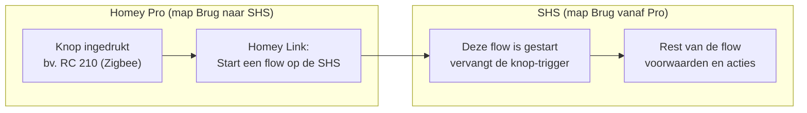

# Flow-verhuizer — handleiding

Nederlandstalige handleiding voor het verhuizen van flows van een Homey Pro naar een Homey Self-Hosted Server (SHS).

## Inhoud

- [Wat de verhuizer doet](#wat-de-verhuizer-doet)
- [Voorbereiding](#voorbereiding)
- [De acht stappen in de app](#de-acht-stappen-in-de-app)
- [Brugflows](#brugflows)
- [Aanbevolen volgorde](#aanbevolen-volgorde)
- [Problemen en oplossingen](#problemen-en-oplossingen)
- [Opruimen na de migratie](#opruimen-na-de-migratie)

## Wat de verhuizer doet

De Flow-verhuizer is een app op de **Self-Hosted Server (SHS)** die je flows, kamers, dashboards en favorieten van de **Homey Pro** naar de SHS kopieert. Op de Pro verandert er niets, behalve de brugflows die je zelf laat aanmaken en de flows die je in stap 6 uitschakelt.

De verhuizer kopieert geen toestellen: Zigbee, Z-Wave en 433 MHz blijven aan de radio van de Pro hangen. Toestellen komen op de SHS ofwel via **Homey Link** (een spiegel van het toestel op de Pro), ofwel doordat je ze rechtstreeks op de SHS toevoegt (wifi- en cloudtoestellen, zoals Growatt, Chint of de Weishaupt-ketel).

**Begrippen**

| Begrip | Betekenis |
| --- | --- |
| Pro | De Homey Pro 2023, waar je flows nu staan. |
| SHS | De Homey Self-Hosted Server in Docker, waar de flows naartoe gaan. |
| Homey Link | App op beide Homeys. Toont toestellen van de andere Homey en kan flows op de andere Homey starten. |
| Koppelen | Voor elk toestel op de Pro het overeenkomstige toestel op de SHS zoeken, zodat de kaarten in de flow naar het juiste toestel wijzen. |
| Link-toestel | Een toestel op de SHS dat via Homey Link een toestel van de Pro spiegelt. Aan/uit, dimmen en metingen werken; app-specifieke kaarten (knoppen van een afstandsbediening, Growatt-acties) niet. |
| Brugflow | Een kleine flow op de Pro die een knop of trigger opvangt en via Homey Link de echte flow op de SHS start. |
| API-sleutel | Een sleutel die je in my.homey.app aanmaakt, zodat de verhuizer op een Homey mag lezen of schrijven. |

De flows worden **uitgeschakeld** aangemaakt. Pas als je in stap 6 omschakelt, gaat de flow op de SHS aan en die op de Pro uit. Zo draait een flow nooit twee keer tegelijk.

## Voorbereiding

Regel deze vijf zaken voor je de verhuizer opent; daarna loopt het meeste vanzelf.

1. **SHS draait en is aangemeld.** Je hebt de SHS toegevoegd via de Homey-app (Homey toevoegen → Self-Hosted Server) en de licentie staat erop.
2. **Homey Link op beide Homeys, in beide richtingen.**
   - Op de SHS: voeg de toestellen van de Pro toe die je in flows gebruikt (Toestellen → + → Homey Link).
   - Op de Pro: verbind de SHS als Homey in de Homey Link-app. Maak daarna op de Pro één flow met de kaart **Homey Link → Start een flow** naar de SHS. Daarmee herkent de verhuizer welke Homey de brugflows moeten starten. Die flow mag je later verwijderen.
   - Na een reset van de SHS is de SHS voor Homey Link een nieuwe Homey: verbind hem opnieuw en verwijder de oude.
3. **Eigen apps installeren.** Draai op de pc het update-script `update-homey-apps.ps1`; het haalt de laatste versie van al je eigen apps van GitHub (Growatt, Chint, Weishaupt, energiedongel, Compacte widgets, Flow-verhuizer) en installeert ze op de Homey die je kiest. Alleen de verhuizer: `update-homey-apps.ps1 -Only homey_flow_mover`.
4. **Twee API-sleutels** (my.homey.app → kies de Homey → Instellingen → API-sleutels → Nieuwe API-sleutel):
   - **Pro**: Flows lezen en schrijven; lezen voor Toestellen, Logica, Zones, Gebruikers en Dashboards; Apps.
   - **SHS**: alle rechten aanvinken.
5. **Wifi- en cloudtoestellen rechtstreeks op de SHS.** Voeg de toestellen van je eigen apps (omvormer, meter, ketel, dongel) op de SHS zelf toe en geef ze **dezelfde naam** als op de Pro. Een Link-versie mist de app-specifieke kaarten, zoals de Growatt-klok synchroniseren.

## De acht stappen in de app

Open op de SHS: Apps → Flow-verhuizer → Instellingen. Werk de stappen van boven naar onder af; na elke wijziging buiten de app (iets toegevoegd, hernoemd, geïnstalleerd) klik je op **Vernieuwen**.

### Stap 1 — Verbinden

Vul het IP-adres van de Pro en de API-sleutel van de Pro in, en daaronder de API-sleutel van de SHS. Ontbreekt een recht, dan zegt de melding welk. Bij succes zie je hoeveel flows en toestellen de Pro heeft.

### Stap 2 — Wat ontbreekt er?

- **Apps**: elke app die je flows of dashboards nodig hebben en die op de SHS ontbreekt, met waar ze gebruikt wordt. Klik **Installeren** voor apps uit de App Store; je eigen apps installeer je met het update-script. Staat er “alle toestellen staan hier al via Homey Link”, dan hoef je de app niet te installeren.
- **Versies**: apps die op de SHS ouder zijn dan op de Pro. Werk ze bij, anders kunnen flowkaarten ontbreken.
- **Ingebouwde toesteltypes**: toestelgroepen kan de verhuizer nabouwen (doe dat pas als de leden gekoppeld zijn); Matter-toestellen en virtuele stopcontacten voeg je zelf toe.
- **Gebruikers**: maakt uitnodigingslinks. Stuur de link naar die persoon; na het aanvaarden kloppen flows met die gebruiker.
- **Variabelen**: worden aangemaakt met dezelfde naam, hetzelfde type en de huidige waarde.

### Stap 3 — Toestellen koppelen

Elk toestel van de Pro krijgt één toestel op de SHS. De verhuizer probeert in deze volgorde:

1. **Via Homey Link**: het Link-toestel onthoudt welk toestel van de Pro het spiegelt. Zekerste koppeling.
2. **Naam + ruimte**: zelfde naam in dezelfde kamer.
3. **Naam + dezelfde actuele waarden**: voor toestellen met dezelfde naam in dezelfde kamer.
4. **Naam alleen**, als er maar één toestel met die naam is.

Twijfelgevallen staan in het geel: kies zelf in de lijst. Je keuze blijft bewaard. Een toestel van je eigen app dat je rechtstreeks op de SHS hebt toegevoegd, kies je hier in plaats van de Link-versie. Met **Ook toestellen tonen die niet in flows staan** zie je alle toestellen; dat telt ook voor stap 4. Achter elk toestel staat in hoeveel flows het gebruikt wordt.

### Stap 4 — Kamers en zones

Bouwt de verdiepingen en kamers van de Pro na en zet elk gekoppeld toestel in dezelfde kamer. Leden van een toestelgroep haalt de verhuizer even uit de groep, verplaatst ze en zet ze terug, omdat Homey een groepslid anders niet laat verhuizen. Staat er daarna iets dubbel of in de verkeerde kamer: **Vernieuwen**.

### Stap 5 — Flows

Kies de flows, per map of met **Selecteer alles zonder probleem**, en klik **Overzetten**. De tekens:

| Teken | Betekenis | Wat doen |
| --- | --- | --- |
| ✓ groen | Klaar | Overzetten. |
| ! oranje | Opmerking, bv. via Homey Link of een brugflow | Lezen; meestal gewoon overzetten. |
| ✕ rood | Probleem: de flow komt over met kapotte kaarten | Eerst oplossen (zie [Problemen en oplossingen](#problemen-en-oplossingen)). |
| = grijs | Er staat al een flow met die naam op de SHS | Overgeslagen. Wil je hem opnieuw: verwijder hem op de SHS, Vernieuwen, opnieuw overzetten. |

Laat **Flows ingeschakeld aanmaken** uit. **Brugflows maken** laat je aan; kies bij **Flows starten op:** je SHS.

### Stap 6 — Omschakelen

Toont per overgezette flow of hij aan of uit staat op de Pro, op de SHS en (indien van toepassing) de brugflow. **Omschakelen naar deze Homey** zet de SHS-flow en de brug aan en de Pro-flow uit. **Terug naar de andere Homey** draait dat om. Schakel per kamer of map om en test meteen.

### Stap 7 — Dashboards

Kopieert dashboards met alle widgets en zet de toestellen, zones en flows erin om. Doe dit na de flows, zodat flow-knoppen kloppen. Vink de optie aan om ook de instellingen van Compacte widgets over te nemen (meterpanelen, iconen, gekozen velden).

### Stap 8 — Favorieten

Neemt je favoriete toestellen, flows en dashboards over, als laatste stap. Herstart daarna de Homey-app op tablet of gsm.

## Brugflows

Een brugflow is nodig als de trigger van een flow alleen op de Pro bestaat, meestal een knop van een afstandsbediening. Link-toestellen op de SHS hebben die knop-trigger niet; de verhuizer meldt dan in stap 5 in het oranje dat de trigger een brugflow wordt.

De verhuizer maakt dan twee flows:

- **Op de SHS**, in de map “Brug vanaf Pro”: de flow zelf, met als trigger “Deze flow is gestart”.
- **Op de Pro**, in de map “Brug naar SHS”: een flow “Brug: &lt;naam&gt;” met de oorspronkelijke knop-trigger en de Homey Link-kaart die de SHS-flow start.

Een brugflow kan niet als de flow de gegevens van de trigger gebruikt (tags zoals welke knop) of meerdere triggers heeft die alleen op de Pro bestaan; dan zegt stap 5 dat automatisch overbruggen niet lukt.

**Moet het wel?** Hangt het licht dat de knop bedient ook aan de Pro (Zigbee), dan wint de flow niets bij een verhuis: laat hem op de Pro en vink hem niet aan. Een brug is nuttig als de acties naar toestellen op de SHS gaan.

## Aanbevolen volgorde

Verhuis per map of per kamer, niet alles in één keer: zo test je telkens een klein stuk en kan je terug.

1. Voorbereiding afwerken (zie hoger), dan stap 1 tot 4 één keer voor het hele huis.
2. Kies in stap 5 één map. Los eerst de rode flows op, zet dan de groene en oranje over.
3. Schakel die map om in stap 6 en test: knoppen, tijden, sensoren.
4. Werkt iets niet: **Terug naar de andere Homey**, oplossen, en opnieuw.
5. Volgende map. Pas als alle flows over zijn: stap 7 (dashboards) en stap 8 (favorieten).

Staat je Homey in het Engels, dan heten de mappen “Bridge to SHS” en “Bridge from Pro”.

## Problemen en oplossingen

Na elke oplossing: **Vernieuwen** in de verhuizer. Bestaat de kapotte flow al op de SHS, verwijder hem daar eerst en zet hem opnieuw over.

**Verbinden: “Missing Scopes” of een ontbrekend recht**

- Oorzaak: De API-sleutel mist een recht.
- Oplossing: Maak een nieuwe sleutel met de rechten uit Voorbereiding.

**Toestel niet gekoppeld**

- Oorzaak: Geen toestel met die naam op de SHS, of meerdere.
- Oplossing: Voeg het toe (via Link of rechtstreeks) met dezelfde naam, of kies het zelf in stap 3.

**Kaart … bestaat niet meer op de Pro (oude toestel-ID)**

- Oorzaak: Het toestel is ooit verwijderd en opnieuw toegevoegd; de kaart wijst nog naar het oude.
- Oplossing: Open de flow op de Pro, verwijder de kaart en voeg ze opnieuw toe, bewaar.

**Op de SHS: “Card unavailable”**

- Oorzaak: Meestal hetzelfde als hierboven, of de verkeerde koppeling.
- Oplossing: Kijk in stap 3 of het toestel “in 1 flow(s)” toont; zo niet, zie hierboven.

**Kaart bestaat niet op deze Homey**

- Oorzaak: App-specifieke kaart die een Link-toestel niet heeft (Growatt, Chint, knoppen).
- Oplossing: Voeg het toestel rechtstreeks op de SHS toe en kies het in stap 3, of laat een brugflow maken.

**App niet geïnstalleerd**

- Oorzaak: De flow gebruikt een app die op de SHS ontbreekt.
- Oplossing: Stap 2: Installeren, of het update-script voor je eigen apps.

**Kies in stap 5 naar welke Homey de brugflows …**

- Oorzaak: De Pro kent de SHS niet in Homey Link.
- Oplossing: Verbind de SHS in Homey Link op de Pro en maak één flow met “Start een flow” (zie Voorbereiding).

**Toestellen staan dubbel of in de verkeerde kamer**

- Oorzaak: Verouderde weergave.
- Oplossing: Vernieuwen in de verhuizer, of herlaad de Homey-app.

**Lampen blijven in de hoofdzone**

- Oorzaak: Groepsleden die niet herkend werden.
- Oplossing: Bijwerken naar de laatste versie (1.15.3 of later) en stap 4 opnieuw.

**Het script installeert een oude versie**

- Oorzaak: Lokale wijzigingen in de app-map.
- Oplossing: Laatste versie van het update-script gebruiken; het zet `app.json` en `package-lock.json` zelf terug.

Kom je er niet uit, open dan in stap 5 **Diagnose (voor ondersteuning)** en stuur dat blok door.

## Opruimen na de migratie

- [ ] Alle flows omgeschakeld en een paar dagen getest.
- [ ] Op de Pro de uitgeschakelde originele flows verwijderen (de brugflows in “Brug naar SHS” laten staan).
- [ ] De testflow met “Start een flow” op de Pro verwijderen.
- [ ] Beide API-sleutels verwijderen in my.homey.app → Instellingen → API-sleutels.
- [ ] De Flow-verhuizer op de SHS mag blijven staan voor later, of verwijderd worden.
